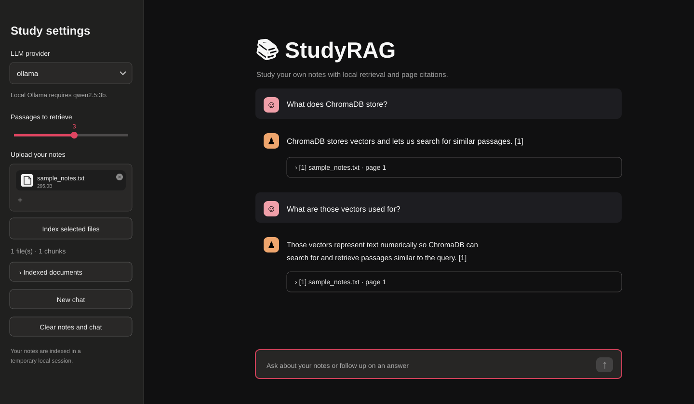

# 📚 StudyRAG

**A free, open-source study assistant for chatting with your own notes, with file and page citations.**

StudyRAG runs on your computer. Upload text-based PDFs, TXT or Markdown files; it finds relevant passages and asks a language model to answer using your notes. Follow-up questions can refer to earlier turns. Source excerpts remain visible under each answer.

**Status:** Open-source portfolio project. Runs locally or as a temporary GitHub Codespaces preview; no permanent cloud deployment is required. The GitHub repository is public and MIT licensed.

## Interface preview



*Illustrated preview based on the locally tested Streamlit interface. Shows a question, a follow-up, and page-aware citations.*

## Features

- 📄 Upload multiple PDF, TXT and Markdown notes (200 MB per file)
- 🧠 CPU-friendly ONNX FastEmbed embeddings and ChromaDB retrieval
- 💬 Follow-up-aware chat with recent conversational context
- 🔖 Expandable citations with original filename, page number and passage text
- 🎛️ Adjustable number of retrieved passages, 1–5
- 🔌 Keyless extractive search; free local Ollama; optional Gemini/Groq free-tier API keys (BYOK)
- 🔒 Temporary per-browser-session index; clear notes and chat when finished
- ✅ Ruff, pytest, GitHub Actions on Ubuntu, macOS and Windows with Python 3.11 and 3.12

## Hosted AI answer setup (one-time, app owner only)

To provide AI-written answers **without asking every student for an API key**, the Streamlit app owner can configure a personal free-tier key using **Manage app → Settings → Secrets**:

```toml
GROQ_API_KEY = "paste-your-personal-free-tier-key-here"
```

Or configure `GEMINI_API_KEY`. Do not commit the real key in GitHub or put it in a public issue. The website automatically selects the configured cloud AI provider when Ollama is unavailable; Ollama remains the default only when it is reachable from the running app server. Free-tier provider quotas are shared by visitors, so requests may stop working when quotas are exhausted. Students' retrieved document passages and recent context are sent to that provider. Without an owner key, students can still use extractive source lookup for free or supply their own free-tier key. A hosted Streamlit app cannot use an Ollama model running on a student's laptop.

Large PDF embeddings are processed in bounded batches to reduce peak memory consumption, but free hosting may still run out of RAM when indexing complex books.

## Easiest option for students: public web app (one-time deployment by owner)

Students should **not** need GitHub accounts, Codespaces, terminals, or installations. Publish StudyRAG once on [Streamlit Community Cloud](https://share.streamlit.io/), then share the generated `*.streamlit.app` URL. Anyone can open the public site and upload notes.

**One-time deployment (repository admin/owner):**
1. Sign in at [Streamlit Community Cloud](https://share.streamlit.io/) with the GitHub repository owner's account.
2. Create app from repository `Mimmmooo/StudyRAG`, branch `fix/cross-platform-reliability` for pre-merge testing (switch to `main` after merge), entrypoint `app.py`; use **Python 3.12**.
3. Deploy and test with `examples/sample_notes.txt`, selecting **extractive** (no API key, no external LLM) and asking `What does ChromaDB store?`.
4. Share the live `streamlit.app` link with students. The owner manages updates; students simply open the link.

**AI responses:** The default **extractive** option returns a matching source excerpt rather than a generated explanation. Students can optionally choose **gemini** or **groq** with their own free-tier key for generated answers. Local Ollama requires a local model server and is not available in the hosted instance. Uploaded documents are processed on the hosting server; extracted passages are stored in a temporary per-session index. Do not upload confidential documents. Free hosting has resource limits and may sleep when idle. This deployment path must be smoke-tested before sharing widely.

**Hosting improvements:** Default embeddings now use CPU-friendly FastEmbed/ONNX rather than PyTorch. For offline use with optional sentence-transformers models, install `requirements-local.txt` and configure `STUDYRAG_EMBEDDING_MODEL`; do not mix models in the same vector collection.

## Run in GitHub cloud (no local installation)

**Recommended for Ubuntu, Windows, and macOS users who don't want to install Python, packages, Ollama, or Git locally.**

1. Sign in to GitHub, visit the [Codespaces creation page for this contribution branch](https://github.com/codespaces/new?hide_repo_select=true&ref=fix%2Fcross-platform-reliability&repo=1448049876), and choose **Create codespace** (prefer the smallest machine).
2. The `.devcontainer/devcontainer.json` configuration installs the Python dependencies **inside GitHub Codespaces** and starts Streamlit on port **8501**. Open the forwarded **StudyRAG Streamlit** port in your browser.
3. Upload notes, select **gemini** or **groq**, and enter **your own free-tier API key** in the password input. These providers receive retrieved passages and recent conversation context. No local installation is required.
4. Stop or delete your Codespace after use to preserve your monthly free quota.

**Important limitations:** Codespaces is a GitHub-hosted *temporary development environment*, not a public always-on app. It needs a GitHub login, an internet connection, and available Codespaces quota; creating a Codespace requires a browser confirmation. It may stop when idle. Ollama is **not preinstalled or running** in Codespaces; use Gemini/Groq BYOK for this path. Avoid uploading sensitive notes to a third-party host. Codespaces has usage-based billing beyond included free quotas, so do not enable paid overages if you want to stay free.

The app and indexing work in GitHub's Codespace; **GitHub Actions only runs tests**, not a persistent app backend. For a shareable permanent URL, a separate free hosting service would be needed and must be validated against memory limits.

## Run StudyRAG locally

Requirements: **Python 3.11 or 3.12** on Ubuntu/Linux, macOS, or Windows. You can use the free Ollama app for AI responses, without any API key.

```bash
git clone https://github.com/Mimmmooo/StudyRAG.git
cd StudyRAG
python3 -m venv .venv
source .venv/bin/activate
python -m pip install -r requirements-dev.txt
python -m ruff check .
python -m pytest -q
python -m streamlit run app.py
```

Open **http://localhost:8501**.

### Start a local model (recommended)

Install [Ollama](https://ollama.com/download), then download the free model:

```bash
ollama pull qwen2.5:3b
ollama list
curl http://localhost:11434/api/tags
```

On macOS, Ollama often runs in the background. If `ollama serve` reports that port 11434 is already in use but the `curl` command returns model data, it is already running. Select **ollama** in StudyRAG.

Alternatively select **gemini** or **groq** and enter your own free-tier API key in the password field. These optional providers transmit retrieved note passages to their services.

### First test

1. Upload `examples/sample_notes.txt` in the sidebar.
2. Click **Index selected files**.
3. Select Ollama (or a configured alternative).
4. Ask **What does ChromaDB store?**
5. The answer should mention vector storage and similar-passage search. Expand **[1] sample_notes.txt · page 1** to inspect the evidence.
6. Follow up with **What are they used for?** to try the multi-turn context feature.

Use **New chat** to reset only the conversation, or **Clear notes and chat** to remove the session index too.

### Update an existing checkout

```bash
cd ~/StudyRAG
git pull origin main
source .venv/bin/activate
python -m pip install -r requirements-dev.txt
python -m ruff check .
python -m pytest -q
python -m streamlit run app.py
```

### Ubuntu / Debian

Install Python, pip, venv and Git first (Ubuntu 22.04+; install Python 3.11 or 3.12 if your distribution uses an older default).

```bash
sudo apt update
sudo apt install -y git python3 python3-venv python3-pip
git clone https://github.com/Mimmmooo/StudyRAG.git
cd StudyRAG
python3 -m venv .venv
source .venv/bin/activate
python -m pip install -r requirements-dev.txt
python -m ruff check .
python -m pytest -q
python -m streamlit run app.py
```

For local inference, install Ollama from its official Linux instructions, start its service, and run `ollama pull qwen2.5:3b`. Or use your own Gemini/Groq free-tier API key.

### Windows (PowerShell)

Install Git and Python 3.11 or 3.12 from their official installers (enable the Python launcher). Then open PowerShell:

```powershell
git clone https://github.com/Mimmmooo/StudyRAG.git
cd StudyRAG
py -3.12 -m venv .venv
.\\.venv\\Scripts\\python.exe -m pip install -r requirements-dev.txt
.\\.venv\\Scripts\\python.exe -m ruff check .
.\\.venv\\Scripts\\python.exe -m pytest -q
.\\.venv\\Scripts\\python.exe -m streamlit run app.py
```

Use `py -3.11` instead if Python 3.11 is installed. This method does not require enabling PowerShell script execution. Install Ollama for Windows and pull `qwen2.5:3b`, or select Gemini/Groq with your own free-tier API key.

**Cross-platform coverage:** GitHub Actions runs Ruff and offline pytest on Ubuntu, macOS and Windows with Python 3.11 and 3.12. Real Ollama/model download and Streamlit browser behavior still require manual checks on each OS.

## How it works

```text
Upload files → Extract pages → Split into chunks → ONNX embeddings → ChromaDB
                                                               ↓
Question + recent turns → Embed query → Retrieve matching passages
                                               ↓
                                 Ollama / Gemini / Groq
                                               ↓
                                 Answer + [1], [2] citations
```

UI logic stays in `app.py`; document ingestion, embeddings, vector search, model adapters, and the RAG pipeline are separate modules under `src/`.

For technical details, see [Architecture](docs/ARCHITECTURE.md).

## Test the code

```bash
python -m ruff check .
python -m pytest -q
python -m scripts.ingest examples/sample_notes.txt
python -m scripts.rag_smoke
```

The default smoke script uses a demo provider and does not generate a factual answer. `python -m scripts.rag_smoke --provider ollama` tests a live Ollama model. GitHub Actions checks Ruff and offline pytest on Python 3.11 and 3.12.

## Limitations and privacy

- The 200 MB per-file upload ceiling does not guarantee successful indexing. Large PDFs may exceed free-hosting RAM or processing time, especially with concurrent users.


- Scanned/image-only PDFs need OCR, which is not yet included.
- TXT and MD files use page 1 as a citation placeholder.
- Generated answers must include valid numbered passage markers, but cited passages remain candidate evidence; they do not automatically verify every generated claim.
- Retrieval distance uses a configurable demo cutoff (`STUDYRAG_MAX_DISTANCE`, default 2.0) and is not calibrated for all documents.
- Follow-up awareness uses a limited number of recent messages, not permanent conversation memory.
- Original uploads are removed after indexing, but extracted passages and embeddings remain in the temporary session index until cleared. The CLI index is stored in a separate local `.chroma/` folder.
- Never commit API keys, `.env` files, private notes or vector databases. For especially sensitive notes, choose local Ollama rather than an external provider.

## Project progress

- [x] Phase 1: Setup
- [x] Phase 2: PDF/TXT/MD ingestion, embeddings, ChromaDB
- [x] Phase 3: Ollama, Gemini, Groq provider adapters
- [x] Phase 4: Grounded RAG with citations
- [x] Phase 5: Streamlit upload and chat
- [x] Phase 6: Automated tests and CI
- [x] Phase 7: README and architecture documentation
- [x] Phase 8: Follow-up-aware chat, UI improvements, regression tests

Cloud deployment is intentionally not part of this project's current goal. If you want to experiment with it later, see the optional [Deployment Guide](docs/DEPLOYMENT.md).

## Contribute and license

Pull requests and bug reports are welcome. Read [CONTRIBUTING.md](CONTRIBUTING.md) and remove any secrets/private text from logs. The project is licensed under [MIT](LICENSE); you can use, modify, and redistribute it under that license.

### Scanned Bengali PDFs

StudyRAG now uses PyMuPDF to read selectable text and automatically falls back to free Bengali/English Tesseract OCR for image-only pages. On Streamlit Cloud, `packages.txt` installs the language data. OCR quality depends on scan resolution and contrast. Large PDFs can be slow; 200 MB is the upload ceiling, not a guaranteed indexing capacity. The provided 66-page Bengali textbook has zero embedded text, and one representative page was verified with Bengali OCR before adding this implementation. Full-book hosted indexing still requires a live smoke test.

### Bengali question retrieval and Ollama hosting boundary

The default CPU ONNX embedding model is now multilingual (`sentence-transformers/paraphrase-multilingual-MiniLM-L12-v2`) and Bengali keyword/title matches are ranked alongside vector results. Existing browser sessions need their notes re-indexed after the change. Exact-term OCR matching is best-effort and will not fix incorrectly recognized letters.

**Ollama is API-key-free only when you run the model on a computer/server that has adequate RAM and stays online.** GitHub repositories and Actions do not provide a persistent inference backend. Streamlit Community Cloud has memory limits and cannot reliably run the existing 3B Ollama model in addition to OCR and vector search. Installing the binary alone does not provide a stable public model server. Streamlit's hosted public app needs either a separately operated Ollama server (with secure private access and authentication) or an owner-configured cloud provider API key. Keys are server-side secrets, never required of students. No paid service is necessary to run StudyRAG locally with Ollama, but a free public 24/7 Ollama deployment cannot be promised with the currently available hosting.
